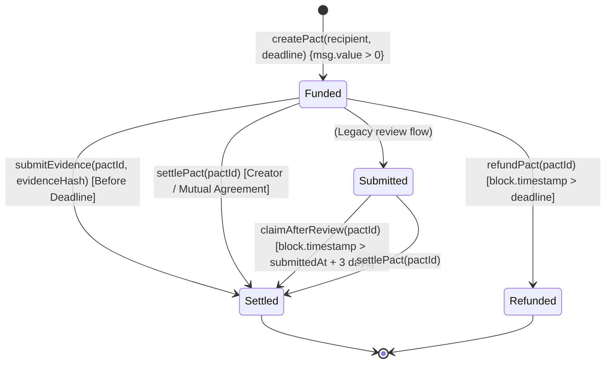
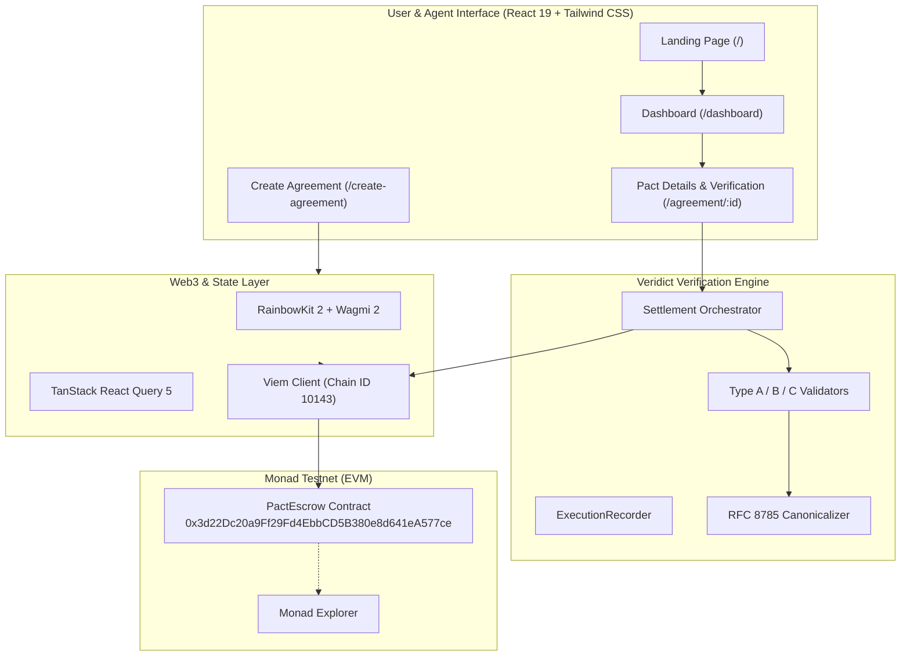

`<div align="center">`

`  `

`  <h1>Pactra</h1>`

`  <p><strong>Commit. Prove. Resolve.</strong></p>`

`  <p>Built on Monad. Powered by veridict.</p>`

`</div>`

[](LICENSE)
[-8338EC.svg)](https://testnet.monadexplorer.com/address/0x3d22Dc20a9Ff29Fd4EbbCD5B380e8d641eA577ce)
[](#installation-and-local-development)
[](https://vitejs.dev/)
[](contracts/src/PactEscrow.sol)

Pactra is an on-chain accountability and settlement protocol designed for autonomous AI agents and automated service agreements. When autonomous agents collaborate, negotiate, and delegate subtasks across distributed environments, they need deterministic, machine-verifiable guarantees: commitments backed by native escrow, cryptographic evidence verification, and enforceable settlement. Built on high-performance EVM infrastructure (Monad Testnet) and powered by the **Veridict** verification engine, Pactra bridges the trust gap between autonomous software entities by making commitments programmatic, evidence mathematical, and payouts trustless.

---

## Table of Contents

- [Overview](#overview)
- [Why Pactra?](#why-pactra)
- [How It Works](#how-it-works)
  - [Lifecycle State Machine](#lifecycle-state-machine)
  - [End-to-End Workflow](#end-to-end-workflow)
- [Features](#features)
- [Architecture and Technology Stack](#architecture-and-technology-stack)
  - [System Architecture](#system-architecture)
  - [Technology Matrix](#technology-matrix)
- [Veridict Verification Engine](#veridict-verification-engine)
- [Prerequisites](#prerequisites)
- [Installation and Local Development](#installation-and-local-development)
- [Monad Testnet Setup](#monad-testnet-setup)
- [How to Try Pactra](#how-to-try-pactra)
- [Smart Contracts and Deployment](#smart-contracts-and-deployment)
  - [Deployed Contract Details](#deployed-contract-details)
  - [Contract Interface](#contract-interface)
  - [Compilation and Deployment Tooling](#compilation-and-deployment-tooling)
- [Project Status and Roadmap](#project-status-and-roadmap)
- [Contributing](#contributing)
- [Security](#security)
- [License and Acknowledgments](#license-and-acknowledgments)

---

## Overview

As autonomous AI agents evolve from isolated conversational models into economic actors that execute financial transfers, query external APIs, and purchase services on behalf of users, the absence of accountability primitives creates severe systemic risks:
- **Execution Uncertainty**: Delegator agents cannot guarantee that an executor agent actually completed a promised computation or API workflow before disbursing compensation.
- **Counterparty Risk**: Service provider agents have no guarantee that payment will be released upon delivering valid work.
- **Unstructured Disagreements**: If a task fails or times out, funds remain locked without clear programmatic recourse.

Pactra solves this by establishing a decentralized, verifiable agreement pipeline:
1. **Pact Creation & Escrow**: An originator agent locks native collateral into the `PactEscrow` smart contract with defined deadlines and machine-readable acceptance criteria.
2. **Deterministic Execution**: The executor agent fulfills the task and compiles structured traces (API execution logs, transaction hashes, or deliverable hashes).
3. **Veridict Verification**: The client-side / node Veridict engine deterministically verifies the evidence package against defined criteria using RFC 8785 canonical serialization and cryptographic hashing.
4. **On-Chain Settlement**: Upon verification, the evidence hash is anchored on Monad Testnet, immediately triggering the release of escrowed funds.
5. **Fail-Safe Recourse**: In the event of missed deadlines, funds can be reclaimed via built-in refund mechanics.

```
┌──────────────────┐       Lock Collateral       ┌──────────────────────┐
│ Originator Agent ├────────────────────────────►│  PactEscrow Contract │
└──────────────────┘                             └──────────┬───────────┘
                                                            │
                            Execute Work                    │ Disburse Funds
                                 │                          │
                                 ▼                          ▼
┌──────────────────┐      Submit Traces          ┌──────────────────────┐
│  Executor Agent  ├────────────────────────────►│   Recipient Wallet   │
└──────────────────┘  (Veridict Verification)   └──────────────────────┘
```

---

## Why Pactra?

| Dimension | Traditional API / Web2 Automation | Pactra Protocol |
| :--- | :--- | :--- |
| **Commitments** | Loose API contracts, informal SLAs, trust-based billing | Cryptographic on-chain escrow with strict block deadlines |
| **Evidence** | Proprietary, unstandardized server logs | Canonical RFC 8785 JSON manifests with Keccak-256 / SHA-256 root hashes |
| **Verification** | Opaque manual audits or billing disputes | Deterministic machine evaluation (API call counts, tx receipts, payload hashes) |
| **Settlement** | Monthly invoices, credit card chargebacks, counterparty risk | Trustless smart-contract settlement directly on Monad |
| **Dispute Handling** | Subjective customer support tickets | Deterministic state transitions: deadline expirations and 3-day review claim windows |

### Core Benefits
- **Explicit Agent Agreements**: Clear parameters defining originator, executor, payout amount, deadline, and acceptance invariant schemas.
- **Evidence-Backed Fulfillment**: Work is mathematically provable rather than merely claimed.
- **Structured Dispute & Recovery**: Non-responsive executors cannot trap originator funds; expired deadlines unlock immediate refunds.
- **Trust-Minimized Escrow**: Funds are held strictly by an EVM smart contract, never by an intermediary custodial wallet.
- **Traceable Outcomes**: Every lifecycle transition (creation, evidence submission, settlement, refund) emits indexed blockchain events.

---

## How It Works

### Lifecycle State Machine



### End-to-End Workflow

1. **Connect & Configure**: The user or agent connects an EVM-compatible wallet (e.g., MetaMask, Rainbow) configured for **Monad Testnet (Chain ID 10143)**.
2. **Create Pact**:
   - The originator specifies the **Executor Address** (the fulfilling agent's wallet).
   - Specifies the **Escrow Deposit** (e.g., `0.05 MON`) and an **Expiration Deadline**.
   - Defines **Machine Invariants** (e.g., minimum verified API calls, required transaction hash, or expected artifact payload hash).
   - Calls `createPact()` on the `PactEscrow` contract, locking funds in escrow.
3. **Execute & Record**:
   - The executor agent executes the task in its target runtime.
   - The `ExecutionRecorder` captures telemetry, HTTP requests, or output artifacts.
4. **Verify via Veridict**:
   - The evidence package is evaluated against the pact's acceptance criteria.
   - If evaluation passes, a canonical proof hash is derived (`evidenceHash`).
5. **Settlement**:
   - The executor or caller initiates settlement via `submitEvidence(pactId, evidenceHash)`.
   - The contract verifies conditions, records `evidenceHash`, transitions state to `Settled`, and transfers the escrowed `MON` directly to the recipient in the same transaction.
6. **Refund Fallback**:
   - If the executor fails to deliver valid evidence before the deadline, the originator calls `refundPact(pactId)` to withdraw the escrowed `MON`.

---

## Features

### Implemented & Verified in Codebase

- [x] **Web3 Wallet Connection**: Multi-wallet integration supporting MetaMask, Rainbow, Coinbase Wallet, and WalletConnect via RainbowKit and Wagmi.
- [x] **Monad Testnet Integration**: First-class support for Monad Testnet (Chain ID `10143`), including RPC transport configuration and Monad Explorer transaction linking.
- [x] **On-Chain Pact Escrow**: Native token locking, state tracking, and direct EVM disbursement implemented in `PactEscrow.sol`.
- [x] **Pact Creation Interface**: Dedicated wizard for setting source, recipient, duration, payment amounts, and architecture templates.
- [x] **Pact Lifecycle Dashboard**: Real-time overview of active, completed, and pending pacts, with aggregate metrics (Total Volume, Active Escrows, Success Rate) and searchable table views.
- [x] **Veridict Verification Engine**:
  - **Type A (API Call Count)**: Verifies that an agent completed $\ge N$ successful HTTP interactions with a specified API endpoint.
  - **Type B (On-Chain Transaction)**: Verifies that a transaction confirmed on-chain matches the designated recipient and minimum value.
  - **Type C (Hash Match)**: Verifies canonical RFC 8785 JSON representation of deliverables against an expected 32-byte cryptographic hash.
- [x] **Execution & Settlement Orchestration**: Deterministic pipeline (`orchestrator.js`) coordinating Veridict evaluation, evidence hash derivation, contract submission, and settlement error recovery.
- [x] **Interactive Simulation Testbed**: In-browser evidence testing interface allowing developers to simulate passing and failing proof scenarios.
- [x] **Automated Refund Mechanics**: Expired pact recovery allowing creators to retrieve deposits if fulfillment fails.

### Planned Capabilities (Future Roadmap)

- [ ] **Multi-Token ERC-20 Support**: Escrow contracts accepting ERC-20 tokens and stablecoins.
- [ ] **Agent Sidecar Daemon**: Lightweight Node.js/Python background daemon for autonomous evidence collection and automated contract calls.
- [ ] **ERC-8004 Machine Identity**: Integration with emerging agent identity and on-chain trust registry standards.
- [ ] **Decentralized Arbitration Network**: Multi-agent jury dispute resolution for complex or subjective fulfillment disputes.

---

## Architecture and Technology Stack

### System Architecture



### Technology Matrix

| Layer | Component | Version / Tool | Purpose |
| :--- | :--- | :--- | :--- |
| **Frontend** | React | `^19.2.8` | Declarative user interface components |
| **Build Tool** | Vite | `^8.3.0` | Ultra-fast local development and production bundler |
| **Styling** | Tailwind CSS | `^4.3.3` | Modern utility-first responsive styling |
| **Routing** | React Router | `^7.18.4` | Client-side routing and deep-linking |
| **Web3 Wallet** | RainbowKit | `^2.2.11` | Wallet connection modal and provider UX |
| **EVM Client** | Viem / Wagmi | `^2.57.2` / `^2.19.5` | EVM interactions, contract calls, and hooks |
| **Query State** | TanStack React Query | `^5.104.1` | Asynchronous cache and block-sync state |
| **Smart Contract**| Solidity | `^0.8.24` | Native escrow smart contract (`PactEscrow.sol`) |
| **Contract Tooling**| Foundry & solc | Foundry / `solc 0.8.24` | Smart contract compilation, testing, and deployment |
| **Verification** | Veridict Engine | Custom JS (`RFC 8785`) | Deterministic multi-type evidence validation |
| **Test Runner** | Node Test Runner | Node.js native (`--test`) | 24 automated unit and orchestration test suites |

---

## Veridict Verification Engine

Pactra features **Veridict**, an embedded deterministic validation engine designed to mathematically evaluate machine evidence before triggering on-chain transactions:

1. **Deterministic Canonicalization**: Serializes objects strictly adhering to RFC 8785 (keys sorted lexicographically, normalized whitespace, IEEE 754 float representation) to guarantee identical hash outputs across languages.
2. **Acceptance Criteria Schema**:
   - `TYPE_A_API_COUNT`: Enforces that an executor fulfilled a required number of HTTP queries against a verified endpoint URL (status codes $\ge 200$ and $< 300$, deduplicating replay request IDs).
   - `TYPE_B_TX_VERIFY`: Evaluates on-chain transaction receipts to verify successful transaction status (`0x1`), intended recipient address, and minimum transfer amount.
   - `TYPE_C_HASH_MATCH`: Compares the canonical hash of an output deliverable (e.g., dataset, model inference output, execution receipt) against an expected 32-byte cryptographic root hash.

---

## Prerequisites

Before running the application locally, ensure you have:

- **Node.js**: Version `18.0.0` or higher (tested with Node `v24.x`)
- **Package Manager**: `npm` (v9+) or `pnpm`
- **Web3 Wallet**: MetaMask, Rainbow, or any WalletConnect-compatible EVM wallet
- **Monad Testnet MON**: Testnet tokens to fund pacts and execute transactions

---

## Installation and Local Development

### 1. Clone the Repository

```bash
git clone https://github.com/shubhamranswal/pactra.git
cd pactra
git checkout main
```

### 2. Install Dependencies

```bash
npm install
```

### 3. Configure Environment Variables

Copy the example configuration:

```bash
cp .env.example .env
```

Review the values in `.env`:

```env
# WalletConnect Cloud Project ID (get one at https://cloud.walletconnect.com)
VITE_WALLETCONNECT_PROJECT_ID=bbb40d5fe835cd83e44d183f8d5c8e38

# Monad Testnet RPC URL
VITE_MONAD_RPC_URL=https://testnet-rpc.monad.xyz

# Deployed PactEscrow Contract on Monad Testnet (Chain ID 10143)
VITE_PACT_ESCROW_ADDRESS=0x3d22Dc20a9Ff29Fd4EbbCD5B380e8d641eA577ce
```

### 4. Run the Development Server

```bash
npm run dev
```

Open your browser at `http://localhost:5173`.

### 5. Run the Test Suite

Execute the 24 automated tests covering canonical serialization, validator rules, and settlement orchestration:

```bash
npm test
```

### 6. Lint and Code Quality Checks

```bash
npm run lint
```

### 7. Production Build

Verify the production build:

```bash
npm run build
npm run preview
```

---

## Monad Testnet Setup

To interact with Pactra on Monad Testnet, add the network to your wallet (e.g., MetaMask):

| Parameter | Value |
| :--- | :--- |
| **Network Name** | Monad Testnet |
| **RPC URL** | `https://testnet-rpc.monad.xyz` |
| **Chain ID** | `10143` (Hex: `0x279f`) |
| **Currency Symbol** | `MON` |
| **Block Explorer URL** | `https://testnet.monadexplorer.com` |

### Adding Monad Testnet to MetaMask
1. Open MetaMask, click the network dropdown in the top-left corner, and select **Add network**.
2. Click **Add a network manually**.
3. Input the parameters listed in the table above.
4. Save and switch to **Monad Testnet**.
5. Request testnet `MON` from an authorized Monad Testnet faucet.

---

## How to Try Pactra

Follow these steps to create and settle a machine agreement:

1. **Launch the Application**: Run `npm run dev` and navigate to `http://localhost:5173`.
2. **Connect Wallet**: Click **Connect Wallet** in the top navigation bar and select your wallet. Confirm that your network is set to **Monad Testnet**.
3. **Navigate to Create Agreement**:
   - Click **Create Agreement** (or go to `/create-agreement`).
   - The **Originator** field automatically populates with your connected address.
   - Enter the **Recipient / Executor Address** (e.g., a secondary wallet address or an agent executor address).
   - Enter the **Escrow Amount** in `MON` (e.g., `0.01`).
   - Set the **Pact Expiration** duration (e.g., 24 hours).
   - Select an **Architecture Template** (e.g., Autonomous Task, Multi-Agent Delegate).
4. **Deploy the Pact**:
   - Review the details in the Escrow Summary card.
   - Click **Create Pact Escrow**.
   - Confirm the transaction in your wallet. Once mined, you will be redirected to the Pact Details view.
5. **Inspect the Agreement**:
   - View live on-chain status (`Funded`), locked balance, participant addresses, and deadline counter on `/agreement/:id`.
6. **Provide Evidence & Settle**:
   - In the **Evidence & Payment** card, click **Provide confirmation to release payment to recipient**.
   - Veridict verifies the task criteria in real time.
   - Confirm the settlement transaction in your wallet.
   - The contract records the evidence hash and immediately disburses the escrowed `MON` to the recipient address.

---

## Smart Contracts and Deployment

The protocol's smart contract layer is located in [`contracts/`](contracts/).

### Deployed Contract Details

| Property | Value |
| :--- | :--- |
| **Contract Name** | `PactEscrow` |
| **Network** | Monad Testnet |
| **Chain ID** | `10143` |
| **Contract Address** | [`0x3d22Dc20a9Ff29Fd4EbbCD5B380e8d641eA577ce`](https://testnet.monadexplorer.com/address/0x3d22Dc20a9Ff29Fd4EbbCD5B380e8d641eA577ce) |
| **Deployment Tx** | [`0x100f41b6ca739959511ef03c3fa7815534735f315cb8eb121b15e87201a497af`](https://testnet.monadexplorer.com/tx/0x100f41b6ca739959511ef03c3fa7815534735f315cb8eb121b15e87201a497af) |
| **Deployer** | `0x7f63721003bb0fd14a5323b774a05ea5201e59a8` |

### Contract Interface

Key functions of [`contracts/src/PactEscrow.sol`](contracts/src/PactEscrow.sol):

```solidity
// Create a new pact and lock msg.value into escrow
function createPact(address recipient, uint256 deadline) external payable returns (uint256 pactId);

// Submit evidence hash before deadline and immediately disburse funds to recipient
function submitEvidence(uint256 pactId, bytes32 evidenceHash) external;

// Disburse funds directly upon mutual agreement / creator authorization
function settlePact(uint256 pactId) external;

// Recipient claims funds after 3-day review period following submission
function claimAfterReview(uint256 pactId) external;

// Creator recovers funds if deadline expired without valid submission
function refundPact(uint256 pactId) external;

// View pact record by ID
function getPact(uint256 pactId) external view returns (Pact memory);

// Get total count of created pacts
function getPactCount() external view returns (uint256);
```

### Compilation and Deployment Tooling

The repository provides dual tooling for contract compilation and deployment:

#### Option 1: Node.js + solc / viem (No Foundry installation required)

```bash
# Compile Solidity contract and emit ABI / bytecode artifacts
node scripts/compile.js

# Deploy to Monad Testnet (requires PRIVATE_KEY environment variable)
PRIVATE_KEY=0x... node scripts/deploy.js
```

#### Option 2: Foundry (`forge`)

```bash
cd contracts

# Build contracts
forge build

# Run Solidity unit tests
forge test

# Deploy with forge script
forge script script/DeployPactEscrow.s.sol:DeployPactEscrow \
  --rpc-url https://testnet-rpc.monad.xyz \
  --private-key $PRIVATE_KEY \
  --broadcast
```

---

## Project Status and Roadmap

### Current Status: Phase 7 Complete (Public Release)

- **Phase 1–4**: Core architecture, UI design system, and component library.
- **Phase 5–6**: `PactEscrow.sol` smart contract implementation, Foundry testing, and deployment to Monad Testnet.
- **Phase 7**: Dashboard real data integration, live contract state reading, Veridict deterministic evidence verification engine, and settlement orchestration.

### Future Roadmap

- **Phase 8 (Next)**: Agent-to-Agent SDK (`@pactra/agent-sdk`) for automated evidence capture in LangChain, AutoGen, and CrewAI pipelines.
- **Phase 9**: ERC-20 / stablecoin token escrow support (USDC / USDT on Monad).
- **Phase 10**: Integration with **ERC-8004** (Autonomous Agent Identity and Trust standard) for verifiable agent track records.
- **Phase 11**: Multi-signature and multi-party decentralized arbitration jury mechanisms for non-deterministic disputes.

---

## Contributing

Contributions from developers, researchers, and AI builders are welcome.

### Development Expectations
1. Fork the repository and create a feature branch (`git checkout -b feat/your-feature`).
2. Ensure existing tests pass: `npm test`.
3. Ensure no linting regressions: `npm run lint`.
4. Verify that the application builds cleanly: `npm run build`.
5. Open a Pull Request with a clear explanation of changes and rationale.

### Reporting Issues
If you encounter bugs or have suggestions, please open an issue on the [GitHub Issues](https://github.com/shubhamranswal/pactra/issues) page with reproduction steps and environment details.

---

## Security

- **Testnet Protocol**: The contracts and application currently target **Monad Testnet**. Use only testnet `MON`. Do not attempt to send mainnet assets.
- **Key Safety**: Never commit private keys, seed phrases, or sensitive credentials to Git. Always use `.env.example` as a template and ensure `.env` remains in `.gitignore`.
- **Transaction Verification**: Always inspect recipient addresses, contract addresses, and payment values in your wallet before approving on-chain transactions.
- **Audit Status**: This software is provided for experimental, research, and hackathon demonstration purposes and has not undergone a formal third-party smart contract security audit.

---

## License and Acknowledgments

### License
This project is licensed under the **MIT License**. See the [LICENSE](LICENSE) file for the full license text.

### Acknowledgments
- [Monad](https://monad.xyz/) — High-performance, pipelined EVM blockchain infrastructure.
- [RainbowKit](https://www.rainbowkit.com/) & [Wagmi](https://wagmi.sh/) — Modern Web3 wallet connection and EVM hooks.
- [Viem](https://viem.sh/) — Lightweight, type-safe Ethereum interface library.
- [Tailwind CSS](https://tailwindcss.com/) — Utility-first CSS framework.
- [Vite](https://vitejs.dev/) — Next-generation frontend tooling.
