# Product Requirements Document (PRD): Gemini Agent — Option A
## Autonomous AI Task Execution, Real Telemetry Recording, Deterministic Veridict Verification, and Recipient-Controlled Monad Escrow Settlement

---

## Document Control & Metadata

| Attribute | Specification |
| :--- | :--- |
| **Document Title** | PACTRA Gemini Agent (Option A) PRD |
| **Target Feature** | Autonomous Gemini Agent Task Execution with Veridict Verification & Recipient MetaMask Settlement |
| **Target Network** | Monad Testnet (EVM Chain ID `10143`) |
| **Smart Contract** | `PactEscrow.sol` deployed at `0x3d22Dc20a9Ff29Fd4EbbCD5B380e8d641eA577ce` |
| **Current Repository Status** | Phase 7 (Option B: Pure client-side simulation testbed implemented and passing 24 unit and mocked integration tests) |
| **Proposed Feature Phase** | Phase 8 (Option A: Real Gemini Agent Execution, Telemetry Recording, Veridict Evaluation, and Recipient Settlement) |
| **Document Version** | 1.1.0-REVISED |
| **Author / Architect** | PACTRA Architecture Team |
| **Status** | AWAITING FINAL APPROVAL (Specification Only — No Code Implemented) |

---

## 1. Product Overview and Objectives

### 1.1 Context and Background
PACTRA is an on-chain accountability and settlement protocol built for autonomous AI agents and automated service agreements on the Monad high-throughput EVM blockchain. In the current repository implementation (Phase 7 Option B), PACTRA provides:
1. An on-chain native token escrow contract (`PactEscrow.sol`) deployed on Monad Testnet (Chain ID `10143`).
2. An off-chain deterministic verification engine (**Veridict**) capable of evaluating machine-verifiable criteria (Type A: API execution counts; Type B: blockchain transaction receipts; Type C: cryptographic payload hash equivalence).
3. Canonical RFC 8785 JSON serialization and Keccak-256 evidence package hashing.
4. An interactive frontend with a simulated execution testbed (`ExecutionVerificationCard.jsx` and `SimulationTestbed.jsx`) where preset test payloads trigger mock verification and simulated settlement.

While Phase 7 demonstrated deterministic verification against synthetic and canned proof fixtures, **Option A** connects the protocol to real AI task execution. In Option A, Google's Gemini models act as autonomous executor agents that receive agreements, execute real tasks using approved external tools, capture authentic runtime execution telemetry, and present verifiable evidence to the human recipient operator.

### 1.2 Core Objectives
1. **Real Autonomous Execution**: Enable a Gemini Agent to fulfill agreed pact obligations using strict, sandbox-approved external tools rather than mock simulation fixtures.
2. **Deterministic Evidence Recording**: Record live telemetry (HTTP calls, responses, on-chain receipts, and computational output digests) using `ExecutionRecorder`, compiling standard RFC 8785 canonical `EvidencePackage` objects.
3. **Application-Level Verification Gate**: Maintain a clear boundary: Gemini executes the task, and **Veridict evaluates the evidence at the application layer**. Gemini cannot verify its own work or declare its output passed.
4. **Clarified On-Chain Contract Truth**: The on-chain contract (`PactEscrow.sol`) does **not** evaluate evidence contents; it accepts any non-zero 32-byte hash and verifies sender authorization. Client-side Veridict evaluation and recipient review serve strictly as an **application-level approval gate** for this MVP.
5. **Zero-Trust Settlement Separation**: Gemini has zero authority or capability to initiate on-chain transactions or touch escrow funds. No private keys are held by the agent or backend service.
6. **Recipient-Only MetaMask Settlement**: Once Veridict renders a deterministic `PASS` verdict, settlement in Option A is enabled **exclusively for the connected recipient wallet**. The recipient operator inspects the execution evidence, verifies the breakdown, and signs the on-chain settlement transaction via MetaMask.
7. **Strict Contract Preservation**: Preserve the existing `PactEscrow.sol` deployment on Monad Testnet without modifying Solidity code, respecting the contract's atomic evidence submission and settlement mechanics.
8. **End-to-End Traceability**: Guarantee that escrow funds are reported as released if and only if the on-chain transaction receipt confirms success on Monad Testnet.

---

## 2. User Stories and End-to-End User Journeys

### 2.1 User Personas
- **Pact Originator (Buyer / Delegator)**: An entity or user who locks MON collateral into escrow to commission automated work with defined acceptance criteria.
- **Recipient Agent Operator (Seller / Provider)**: The entity running or managing the executor Gemini agent, whose EVM address is specified as `recipient` in the on-chain pact.
- **Auditor / Observer**: Any third party verifying on-chain pact commitments, evidence hashes, and transaction receipts on Monad Explorer.

### 2.2 User Stories

| ID | Persona | Action | Benefit / Outcome |
| :--- | :--- | :--- | :--- |
| **US-01** | Originator | Defines pact terms with machine-readable criteria (Type A, B, or C). | Ensures unambiguous fulfillment conditions backed by locked MON escrow. |
| **US-02** | Recipient Operator | Initiates Gemini Agent execution against a funded pact from the PACTRA dashboard. | Delegates task execution to Gemini using approved tool capabilities. |
| **US-03** | Recipient Operator | Observes live agent execution traces, tool invocations, and telemetry collection in real time. | Gains transparent visibility into what the autonomous agent is doing. |
| **US-04** | Veridict Engine | Ingests the recorded `EvidencePackage` and objectively evaluates each criterion. | Generates an application-level deterministic `PASS` or `FAIL` verdict independent of Gemini's self-assessment. |
| **US-05** | Recipient Operator | Reviews Veridict's criteria breakdown and evidence manifest before signing. | Confirms all terms are satisfied before broadcasting on-chain transactions. |
| **US-06** | Recipient Operator | Signs the on-chain settlement transaction through MetaMask. | Authorizes `submitEvidence(pactId, evidenceHash)` strictly from their authorized recipient wallet. |
| **US-07** | Both Parties | Views confirmed settlement on Monad Testnet with verified event logs. | Ensures trustless payout only occurs when work is proven and confirmed on-chain. |

### 2.3 End-to-End User Journey (Option A Recipient Path)

```mermaid
sequenceDiagram
    autonumber
    actor Originator as Pact Originator
    actor Recipient as Recipient Operator (MetaMask)
    participant UI as PACTRA Frontend
    participant Server as Backend Agent Service
    participant Gemini as Gemini Agent (LLM)
    participant Tools as Approved Tools Sandbox
    participant Veridict as Veridict Engine (Client)
    participant Escrow as PactEscrow.sol (Monad Testnet)

    Originator->>Escrow: createPact{value: 1.0 MON}(recipient, deadline)
    Escrow-->>UI: PactCreated(id=101, amount=1.0 MON, recipient)
    
    Note over Recipient, UI: Recipient opens Pact #101 Details page with MetaMask connected
    Recipient->>UI: Clicks "Run Gemini Agent"
    UI->>Server: POST /api/agent/execute { pactId: 101 }
    
    rect rgb(20, 25, 35)
        Note over Server, Escrow: Authoritative State Verification
        Server->>Escrow: getPact(101) via Monad RPC
        Escrow-->>Server: Authoritative State (recipient, amount, deadline, status=Funded)
        Server->>Server: Look up agreed criteria from Server Pact Registry
    end
    
    rect rgb(20, 25, 35)
        Note over Server, Tools: Autonomous Execution & Telemetry Recording
        Server->>Gemini: Prompt with Task + Authoritative Criteria + Tool Schemas
        Gemini->>Tools: Tool Call (e.g., executeApiCall, inspectTx, hashDigest)
        Tools-->>Server: Real Output
        Server->>Server: ExecutionRecorder records trace (HTTP / TX / Tool)
        Tools-->>Gemini: Tool Result
        Gemini->>Server: Final Completion Response
    end
    
    Server->>Server: compileEvidencePackage() -> compute evidenceHash
    Server-->>UI: Return { result, evidencePackage, evidenceHash, traces }
    
    rect rgb(25, 30, 45)
        Note over UI, Veridict: Application-Level Verification Gate
        UI->>Veridict: VeridictEngine.evaluate(terms, evidencePackage)
        Veridict-->>UI: Verdict: "PASS" (Criteria 100% satisfied)
    end
    
    Note over UI, Recipient: Recipient Authorization Check
    UI->>UI: Check connectedAddress === pact.recipient
    UI->>Recipient: Render "Verification PASSED" + Evidence Manifest + Enable "Claim Escrow via MetaMask"
    Recipient->>UI: Clicks "Sign Settlement via MetaMask"
    UI->>Recipient: MetaMask prompts: submitEvidence(101, evidenceHash)
    Recipient->>Escrow: Broadcasts signed tx via MetaMask
    Escrow->>Escrow: Verifies msg.sender == recipient & status == Funded
    Escrow->>Recipient: Direct Native Transfer (1.0 MON)
    Escrow-->>UI: EvidenceSubmitted + PactSettled events
    UI-->>Recipient: UI updates to SETTLED, shows receipt & Monad Explorer link
```



---

## 3. Functional and Non-Functional Requirements

### 3.1 Functional Requirements

- **FR-01 (Agent Dispatch)**: The system must allow users to initiate Gemini execution for any on-chain pact in `Funded` status (`status === 0`).
- **FR-02 (Secure Agent Proxy)**: The frontend must never communicate directly with Google Gemini APIs or store Gemini API keys. All agent requests must pass through a dedicated backend API route.
- **FR-03 (Approved Tools Sandbox)**: The agent execution runtime must only permit calls to pre-approved, deterministic tools (whitelisted HTTP API caller, Monad blockchain reader, and cryptographic digest computer).
- **FR-04 (Telemetry Capture)**: Every tool execution must automatically produce a deterministic trace entry in `ExecutionRecorder` containing timestamps, identifiers, inputs, outputs, and status codes.
- **FR-05 (Canonical Manifest Compilation)**: Upon agent completion, traces must be packaged into an RFC 8785 canonical JSON `EvidencePackage` with a calculated Keccak-256 `evidenceHash`.
- **FR-06 (Independent Veridict Verification)**: The client application must feed the `EvidencePackage` into `VeridictEngine.evaluate()`. The agent's natural-language claims or self-reported success must have zero influence on Veridict's verdict.
- **FR-07 (Strict Settlement Gate)**: If Veridict evaluates to `FAIL`, the MetaMask settlement action must remain strictly disabled. The UI must present detailed failure reasons and prohibit on-chain submission.
- **FR-08 (Recipient-Only Settlement Gate in UI)**: Settlement in Option A is enabled **only** when all of the following conditions are met:
  1. `connectedAddress.toLowerCase() === pact.recipient.toLowerCase()`.
  2. `verdict === "PASS"`.
  3. Connected network is Monad Testnet (`chainId === 10143`).
  4. Pact is in `Funded` status (`status === 0`) and block timestamp has not passed the deadline.
  *(If the connected address is `pact.creator`, Option A settlement remains disabled; creator authorization in the contract must not be represented as recipient approval).*
- **FR-09 (MetaMask Transaction Flow)**: Upon recipient confirmation, MetaMask must prompt the user to sign `submitEvidence(pactId, evidenceHash)`.
- **FR-10 (Receipt Confirmation & Status Transition)**: The UI state must transition to `SETTLED` if and only if `waitForTransactionReceipt` returns a receipt with status `success` (`1` or `1n`).
- **FR-11 (Preservation of Existing State Machine)**: The system must accurately handle pact state changes, preventing duplicate submissions for pacts already `Settled` (`status === 2`) or `Refunded` (`status === 3`).
- **FR-12 (No Simulated Evidence as Live Evidence)**: Real execution mode must never represent mock or simulated fixtures as live evidence. If test endpoints are used during demonstration, they must be clearly labeled as test endpoints.

### 3.2 Non-Functional Requirements

- **NFR-01 (Security & Key Isolation)**: Neither the backend nor the agent may possess, generate, store, or receive EVM private keys. Private keys remain exclusively inside the user's browser-managed MetaMask wallet.
- **NFR-02 (Determinism)**: Given identical execution traces, `hashCanonical(evidencePackage)` and `VeridictEngine.evaluate()` must produce the exact same byte hash and boolean result across any machine, browser, or environment.
- **NFR-03 (Latency & Responsiveness)**: Agent execution must provide staged status updates to the UI, completing typical tasks within 15 seconds.
- **NFR-04 (Auditability)**: The entire raw `EvidencePackage` and trace log must be viewable and exportable as JSON in the UI for cryptographic and technical inspection.
- **NFR-05 (Error Resilience)**: Network drops, RPC timeouts, or user wallet rejections must fail gracefully with intelligible error messages without corrupting pact state or causing unrecoverable errors.

---

## 4. Gemini Agent Architecture and Approved Tool Capabilities

### 4.1 Agent Architecture Overview
The Gemini Agent operates as a controlled task-execution engine governed by function calling (tool use). The agent does not have free-form Internet browsing or arbitrary code execution capabilities; it interacts exclusively via structured tools configured in the backend execution harness.

```
┌────────────────────────────────────────────────────────┐
│                   PACTRA Client (UI)                   │
└───────────────────────────┬────────────────────────────┘
                            │ POST /api/agent/execute { pactId }
                            ▼
┌────────────────────────────────────────────────────────┐
│             Backend Agent Service (Express)            │
│  ┌──────────────────────────────────────────────────┐  │
│  │ 1. On-Chain RPC Query: getPact(pactId)           │  │
│  │ 2. Server Pact Registry: Fetch Agreed Criteria   │  │
│  └──────────────────────────┬───────────────────────┘  │
│                             │ Authoritative Context    │
│                             ▼                          │
│  ┌──────────────────────────────────────────────────┐  │
│  │ Google Gen AI SDK (@google/genai)                │  │
│  │ Verified Model: gemini-2.5-flash                 │  │
│  └──────────────────────────┬───────────────────────┘  │
│                             │ Structured Tool Calls    │
│                             ▼                          │
│  ┌──────────────────────────────────────────────────┐  │
│  │ Strict Tool Sandbox (SSRF Protected)             │  │
│  │  - tool_api_caller (Whitelisted Destinations)    │  │
│  │  - tool_blockchain_query (Monad Testnet RPC)     │  │
│  │  - tool_crypto_hasher (RFC 8785 + Keccak-256)    │  │
│  └──────────────────────────┬───────────────────────┘  │
│                             │ Real Telemetry           │
│                             ▼                          │
│  ┌──────────────────────────────────────────────────┐  │
│  │ ExecutionRecorder -> Manifest Compiler           │  │
│  │ Canonical EvidencePackage + evidenceHash         │  │
│  └──────────────────────────────────────────────────┘  │
└───────────────────────────┬────────────────────────────┘
                            │ Returns Manifest + Traces
                            ▼
┌────────────────────────────────────────────────────────┐
│               Client-Side Veridict Engine              │
│       Application-Level Deterministic Approval Gate    │
└────────────────────────────────────────────────────────┘
```

### 4.2 Approved Tool Capabilities & Strict Outbound HTTP Controls

#### 1. `tool_api_caller` (External Telemetry Caller)
- **Purpose**: Executes HTTP calls required by pact terms (Type A criteria).
- **Outbound HTTP Controls**:
  - **Protocol Restriction**: Must strictly be `http:` or `https:`.
  - **Allowed Methods**: Strictly `GET` and `POST`. All other HTTP methods (`PUT`, `DELETE`, `PATCH`, `HEAD`, `OPTIONS`) are rejected.
  - **Destination Validation (Host Allowlist)**: The target hostname must match an explicit pre-configured allowlist:
    - Production allowlist: Pre-registered, verified external partner APIs.
    - Local/Dev test allowlist: `http://localhost:3001/api/test-telemetry` (clearly labeled test endpoint).
    - Note on `api.pactra.network`: Testing against real DNS confirms `api.pactra.network` does **not** resolve (`NXDOMAIN`). Fictitious endpoints are strictly prohibited for live execution; for development and testing, the dedicated local test endpoint `http://localhost:3001/api/test-telemetry` must be used and explicitly labeled as a test fixture.
  - **SSRF Prevention & IP Filtering**:
    - Disallows requests targeting private IPv4 and IPv6 ranges: `10.0.0.0/8`, `172.16.0.0/12`, `192.168.0.0/16`, `169.254.0.0/16` (cloud link-local / instance metadata), `0.0.0.0/8`, `::1`, and broadcast addresses.
    - Disallows loopback (`127.0.0.0/8` / `localhost`) *except* when explicitly configured in `development` mode to target the local mock telemetry endpoint.
    - DNS rebinding defense: Resolves hostname to IP before dispatching and verifies IP is not in private range.
  - **Redirect Handling**: Automatic redirects are **disabled** (`redirect: 'manual'` or `'error'`). If a redirect response (3xx) is received, it is treated as non-2xx status and not followed, preventing redirect-based SSRF.
  - **Timeout Bound**: Hard timeout of 5,000 ms per request.
  - **Payload Limits**: Max request payload size: 64 KB; max response payload size: 1 MB (stream truncated if exceeded to prevent memory exhaustion).
  - **Telemetry Captured**: `ExecutionRecorder.recordApiCall({ id, url, method, status, responseData })`.

#### 2. `tool_blockchain_query` (Monad Testnet Reader)
- **Purpose**: Inspects Monad Testnet blocks, transaction receipts, or address balances (Type B criteria).
- **Constraints**: Read-only queries to configured `VITE_MONAD_RPC_URL` (`https://testnet-rpc.monad.xyz`). No `eth_sendRawTransaction` or state-modifying RPC methods.
- **Telemetry Captured**: `ExecutionRecorder.recordBlockchainTx({ txHash, from, to, value, blockNumber, status })`.

#### 3. `tool_crypto_hasher` (Cryptographic Digest Generator)
- **Purpose**: Computes canonical JSON formatting and cryptographic hashes (Type C criteria).
- **Constraints**: Uses standard RFC 8785 canonical serialization and Keccak-256 / SHA-256.
- **Telemetry Captured**: `ExecutionRecorder.recordToolOutput({ toolName, outputPayload })`.

### 4.3 Explicitly Prohibited Capabilities
1. **NO Wallet / Private Key Operations**: The agent has no access to private keys, signing capabilities, or `sendTransaction` endpoints.
2. **NO Arbitrary Code Execution**: No `eval()`, shell execution, or arbitrary file system access.
3. **NO Self-Verification Overrides**: The agent cannot emit a field claiming `verified: true` or bypass Veridict.
4. **NO Direct Monad State Mutation**: The agent cannot invoke state-modifying smart contract methods (`createPact`, `submitEvidence`, `settlePact`, `refundPact`).

---

## 5. Authoritative Pact Data, Real Execution Recording, and Evidence Manifest

### 5.1 Authoritative Pact Data Resolution (Architectural Blocker & Resolution)

#### The Blocker
Inspection of `contracts/src/PactEscrow.sol` shows that the on-chain `Pact` struct:
```solidity
struct Pact {
    uint256 id;
    address creator;
    address recipient;
    uint256 amount;
    uint256 createdAt;
    uint256 deadline;
    uint256 submittedAt;
    PactStatus status;
    bytes32 evidenceHash;
}
```
**does not store acceptance criteria, task prompts, or a `termsHash` on-chain.** The contract records only financial and temporal terms (`amount`, `creator`, `recipient`, `deadline`, `status`).

If the backend were to blindly trust client-supplied `criteria`, `recipient`, or `deadline` sent in `POST /api/agent/execute`, a malicious client could alter criteria to guarantee an easy `PASS` verdict.

#### Smallest Safe Resolution for MVP (Without Contract Modification)
To preserve the deployed contract at `0x3d22Dc20a9Ff29Fd4EbbCD5B380e8d641eA577ce`:
1. **Authoritative On-Chain Lookup**: When `POST /api/agent/execute` is invoked with `{ pactId }`, the backend connects directly to Monad Testnet RPC via `viem` to fetch the authoritative on-chain pact record:
   - Verifies pact exists and status is `Funded` (`status === 0`).
   - Retrieves authoritative `recipient`, `creator`, `amount`, and `deadline`.
   - Rejects execution if deadline has passed.
2. **Server-Side Immutable Pact Specification Registry**:
   - The backend maintains an authoritative catalog of agreed pact criteria and task specifications mapped by `pactId` (or pre-agreed template ID).
   - The backend completely **ignores and discards** any client-supplied `criteria`, `recipient`, or `amount`.
   - The criteria used to prompt Gemini and compile the evidence package originate strictly from this server-side registry.
3. **Future Contract Evolution Note**: A future contract upgrade should introduce a `bytes32 termsHash` field in `createPact(address recipient, uint256 deadline, bytes32 termsHash)` so that the commitment to agreed criteria is immutably anchored on-chain. For this MVP, the server-side registry + on-chain state verification provides the necessary security guarantee without breaking contract compatibility.

### 5.2 Real Telemetry Collection & Manifest Compilation
- **Telemetry Recorder**: During execution, every tool invocation records a trace with a unique identifier into `ExecutionRecorder`.
- **Manifest Compilation (`compileEvidencePackage`)**:
  ```json
  {
    "pactId": "101",
    "pactTermsHash": "0x4f8c...3a19",
    "executor": "0x70997970C51812dc3A010C7d01b50e0d17dc79C8",
    "timestamp": 1791112510,
    "items": [
      {
        "criterionId": 1,
        "type": "TYPE_A_API_COUNT",
        "calls": [
          { "id": "trace_1", "url": "http://localhost:3001/api/test-telemetry", "method": "POST", "status": 200 },
          { "id": "trace_2", "url": "http://localhost:3001/api/test-telemetry", "method": "POST", "status": 200 },
          { "id": "trace_3", "url": "http://localhost:3001/api/test-telemetry", "method": "POST", "status": 200 }
        ]
      },
      {
        "criterionId": 2,
        "type": "TYPE_C_HASH_MATCH",
        "outputPayload": {
          "status": "verified_execution",
          "completedAt": 1791112500
        }
      }
    ]
  }
  ```

---

## 6. Canonicalization, Cryptographic Hashing, and Veridict Evaluation

### 6.1 Exact Canonical Bytes Definition
To ensure 100% cross-platform determinism, both server and client utilize the exact same canonicalization and hashing pipeline defined in `src/lib/veridict/canonical.js`:

1. **RFC 8785 JSON Canonicalization (`canonicalJson`)**:
   - Recursively sorts all object keys by UTF-16 code units (`Object.keys(data).sort()`).
   - Strips all arbitrary whitespace between keys, values, and array items.
   - Serializes standard types:
     - `null` $\rightarrow$ `"null"`
     - `boolean` $\rightarrow$ `"true"` or `"false"`
     - `number` $\rightarrow$ IEEE 754 finite representation via `JSON.stringify(num)`. (Throws error on `NaN` or `Infinity`).
     - `string` $\rightarrow$ Standard JSON string escaping.
     - `bigint` $\rightarrow$ String conversion: `JSON.stringify(bigint.toString())`.
2. **Byte Conversion (`stringToBytes`)**:
   - Converts the canonical JSON string into raw UTF-8 encoded bytes (`Uint8Array`).
3. **Cryptographic Hashing (`keccak256`)**:
   - Applies the standard EVM Keccak-256 algorithm to the UTF-8 bytes to yield a 32-byte hexadecimal hash (`0x` + 64 hex characters).

### 6.2 Parity Tests Requirement
Both backend and frontend must execute automated parity tests against a fixed suite of 5 diverse test fixture packages, verifying that `hashCanonical(package)` produces the **exact same 32-byte string** on Node.js (server) and browser environments.

### 6.3 Critical Clarification: Integrity vs. Truth
> [!IMPORTANT]
> **Cryptographic hashing proves integrity of the committed package, NOT the truth of underlying events.**
> A valid `evidenceHash` mathematically proves that the `EvidencePackage` JSON document has not been altered, truncated, or tampered with since hashing. It does **not** prove that an external API actually returned a given response or that the agent did not fabricate logs.
> 
> Therefore:
> 1. Veridict performs deterministic structural validation on the package (checking counts, endpoints, status codes, and receipt parameters).
> 2. The recipient operator performs a human-in-the-loop review of the execution trace before authorizing payment.
> 3. The smart contract acts as an immutable escrow anchor, recording the evidence hash upon release.

### 6.4 Veridict Evaluation Rules
`VeridictEngine.evaluate({ pact, terms, evidencePackage, publicClient })`:
- **Type A**: Requires `validCallsCount >= criterion.minimumCount` with `status >= 200 && status < 300` matching `criterion.targetEndpoint`, discarding duplicate call IDs.
- **Type B**: Queries on-chain receipt on Monad Testnet, verifying `status === "success"`, `to.toLowerCase() === criterion.recipient.toLowerCase()`, `value >= criterion.minimumAmountWei`, and `timestamp <= deadline`.
- **Type C**: Computes `hashCanonical(outputPayload)` and checks strict equality with `criterion.expectedHash`.
- **Verdict**: Strictly `PASS` if all criteria pass; `FAIL` if any criterion fails.

---

## 7. Recipient-Controlled MetaMask Approval and Escrow-Release Workflow

### 7.1 Smart Contract Investigation & On-Chain Behavior
Inspection of lines 108–160 in `contracts/src/PactEscrow.sol`:
```solidity
function submitEvidence(uint256 pactId, bytes32 evidenceHash) external nonReentrant {
    if (pactId == 0 || pactId > _pactIdCounter) revert PactDoesNotExist();

    Pact storage pact = _pacts[pactId];

    if (msg.sender != pact.recipient && msg.sender != pact.creator) revert UnauthorizedRecipient();
    if (evidenceHash == bytes32(0)) revert ZeroEvidenceHash();
    if (pact.status != PactStatus.Funded) revert InvalidPactState();
    if (block.timestamp > pact.deadline) revert DeadlinePassed();

    pact.evidenceHash = evidenceHash;
    pact.submittedAt = block.timestamp;
    pact.status = PactStatus.Settled;

    uint256 amount = pact.amount;
    address recipient = pact.recipient;

    emit EvidenceSubmitted(pactId, msg.sender, evidenceHash);
    emit PactSettled(pactId, recipient, amount);

    (bool success,) = recipient.call{value: amount}("");
    if (!success) revert TransferFailed();
}
```

### 7.2 Key Realities of the Existing Contract
1. **Contract Accepts Any Non-Zero Hash**:
   `PactEscrow.sol` has no EVM-level knowledge of Veridict or evidence contents. It requires only `evidenceHash != bytes32(0)`.
2. **Direct Atomic Settlement**:
   Calling `submitEvidence()` immediately sets `status = PactStatus.Settled` and transfers escrowed MON to `pact.recipient` in the **same transaction**.
3. **Contract Caller Authorization**:
   The contract allows either `msg.sender == pact.recipient` OR `msg.sender == pact.creator`.
4. **Option A Enforcement Policy (Recipient-Only)**:
   In Option A, **only the recipient may approve settlement**.
   - If `connectedAddress === pact.recipient`, the UI enables the settlement button (provided Veridict passed).
   - If `connectedAddress === pact.creator`, the UI **disables** the Option A recipient settlement button. The UI must **never** describe creator settlement as recipient approval.
   - If an unconnected or third-party address is connected, settlement is disabled.

### 7.3 MetaMask Transaction Flow
1. Recipient clicks **"Sign & Release Escrow to Recipient"**.
2. MetaMask prompts recipient to sign:
   `submitEvidence(pactId, evidenceHash)`
3. Transaction is broadcast to Monad Testnet (Chain ID `10143`).
4. Frontend waits for receipt confirmation (`waitForTransactionReceipt`).
5. Only upon receipt confirmation (`status === 1`), UI updates to `SETTLED`.

---

## 8. UI/UX States, Errors, and Retry Behavior

### 8.1 State Machine

| State | Badge / Color | Condition & Behavior | Available User Actions |
| :--- | :--- | :--- | :--- |
| `IDLE` | Blue ("FUNDED") | Pact is funded on-chain; agent has not run. | "Run Gemini Agent" button enabled. |
| `AGENT_RUNNING` | Amber pulse | Backend is executing Gemini loop & approved tools. | "Cancel" button; settlement disabled. |
| `RECORDING_EVIDENCE` | Purple | Raw traces being converted into `EvidencePackage`. | None (transient). |
| `VERIFYING` | Cyan pulse | Client-side Veridict evaluating criteria. | None (transient). |
| `VERIFICATION_FAILED` | Red alert | One or more criteria failed Veridict check. | "Re-run Agent", "Inspect Traces". Settlement disabled. |
| `READY_FOR_APPROVAL` | Green glow | Veridict `PASS`, connected wallet matches `recipient`. | "Sign & Release Escrow via MetaMask" enabled. |
| `WALLET_MISMATCH` | Amber warning | Veridict `PASS`, but connected wallet $\ne$ `recipient`. | Button disabled. Prompt to switch MetaMask account. |
| `AWAITING_SIGNATURE` | Amber wallet | MetaMask prompt is active on user screen. | User signs or rejects in MetaMask. |
| `CONFIRMING_ON_CHAIN`| Blue spinner | Transaction broadcast; waiting for Monad block. | Monad Explorer link active. |
| `SETTLED` | Emerald badge | Block confirmed on-chain (`receipt.status === 1`). | "View on Monad Explorer", "Export Evidence JSON". |
| `ERROR` | Red banner | Network error, RPC timeout, or wallet rejection. | "Retry Action" button. |

### 8.2 Formatted Error Feedback

```
┌───────────────────────────────────────┬────────────────────────────────────────────────────────┐
│ Error Scenario                        │ Formatted User Message                                 │
├───────────────────────────────────────┼────────────────────────────────────────────────────────┤
│ MetaMask user rejection               │ "Transaction signature was cancelled in your wallet."  │
│ Connected wallet is not recipient     │ "Connected wallet (0x...) is not the pact recipient."   │
│ Connected wallet is creator           │ "Connected as Creator. Only the Recipient can claim."   │
│ RPC communication failure             │ "Unable to reach Monad Testnet RPC. Please retry."     │
│ Pact deadline has expired             │ "Pact deadline has passed. Evidence cannot be accepted."│
│ Gemini rate limit or API failure      │ "Gemini agent error: Rate limit reached. Please retry."│
│ Evidence verification failure         │ "Evidence failed Veridict validation: [Specific Error]" │
└───────────────────────────────────────┴────────────────────────────────────────────────────────┘
```

---

## 9. Backend APIs, Environment Configuration, and Defaults

### 9.1 Server Architecture Default: Standalone Express Service
- **Default**: Standalone Node.js Express server running on port `3001` (`server/index.js`), with Vite reverse-proxying `/api` in development.
- **Rationale**: Completely isolates `GEMINI_API_KEY` from Vite's frontend bundle, provides dedicated process isolation for tool execution and SSRF filtering, and matches production deployment.

### 9.2 Gemini Model & SDK Defaults
- **SDK**: `@google/genai` (official Google Gen AI SDK).
- **Default Model**: `gemini-2.5-flash` for high speed, deterministic tool use, and cost efficiency.
- **Fallback Model**: `gemini-1.5-flash`.
- **Startup Verification**: On startup, `server/index.js` performs a verification probe (`client.models.get({ model: 'gemini-2.5-flash' })`) to confirm API key validity before enabling agent endpoints.

### 9.3 API Specifications

#### 1. `POST /api/agent/execute`
- **Request Body**:
  ```json
  {
    "pactId": "1"
  }
  ```
  *(Note: Criteria, recipient, and amount are NOT accepted from the client; they are derived authoritatively).*
- **Processing**:
  1. Queries Monad Testnet RPC `getPact(pactId)`.
  2. Retrieves authoritative criteria from the Server Pact Registry.
  3. Executes Gemini with approved tools and `ExecutionRecorder`.
  4. Compiles `EvidencePackage` and computes `evidenceHash`.
- **Response (200 OK)**:
  ```json
  {
    "success": true,
    "pactId": "1",
    "executionLog": "Executed 3 telemetry calls to test endpoint. Output digest generated.",
    "traces": [ ... ],
    "evidencePackage": { ... },
    "evidenceHash": "0x8b3f...e4a1"
  }
  ```

#### 2. `GET /api/agent/health`
- **Response**: `{ "status": "healthy", "sdkVerified": true, "model": "gemini-2.5-flash", "network": 10143 }`

#### 3. `POST /api/test-telemetry` (Dedicated Local Test Endpoint)
- **Description**: Controlled test endpoint for Type A telemetry during development and automated tests.
- **Response**: `{ "acknowledged": true, "timestamp": 1791112501, "batchId": "test_batch" }`

### 9.4 Environment Variables Matrix

| Variable | Environment | Description | Required? |
| :--- | :--- | :--- | :--- |
| `GEMINI_API_KEY` | Server-Side Only | Google Gemini API key for agent execution | **Yes** |
| `GEMINI_MODEL` | Server-Side Only | Model version (default: `gemini-2.5-flash`) | Optional (defaults to `gemini-2.5-flash`) |
| `AGENT_PORT` | Server-Side Only | Backend service port (default: `3001`) | Optional (default: 3001) |
| `VITE_MONAD_RPC_URL` | Client & Server | Monad Testnet RPC endpoint | Yes (`https://testnet-rpc.monad.xyz`) |
| `VITE_PACT_ESCROW_ADDRESS`| Client & Server | Deployed `PactEscrow` contract address | Yes (`0x3d22Dc20a9Ff29Fd4EbbCD5B380e8d641eA577ce`) |
| `VITE_WALLETCONNECT_PROJECT_ID` | Client Only | WalletConnect Cloud Project ID | Yes |

---

## 10. Security, Privacy, Idempotency, and Failure-Handling Requirements

### 10.1 Key Management & Zero-Custody Security
1. **Zero Private Keys**: No private keys or wallet mnemonics exist anywhere on the backend or in the Gemini context.
2. **API Key Isolation**: `GEMINI_API_KEY` is loaded strictly into server-side environment variables and never prefixed with `VITE_` or exposed in client bundles.
3. **Frontend Origin Verification**: Backend endpoints implement CORS restrictions ensuring only requests from the authorized frontend origin are accepted.

### 10.2 Prompt Injection & Model Safety Guardrails
1. **Tool Schema Restraints**: Tool inputs are strictly validated against JSON schema types before invocation.
2. **Deterministic Whitelisting**: Outbound HTTP caller only allows connections to explicitly approved destination hosts with SSRF protection.
3. **No Direct System Modification**: Gemini cannot modify terms, update invariants, or alter on-chain state directly.

### 10.3 Idempotency & Replay Protection
1. **Contract-Level Replay Protection**:
   `PactEscrow.sol` enforces `if (pact.status != PactStatus.Funded) revert InvalidPactState()`. Once a pact transitions to `Settled`, any duplicate `submitEvidence` call immediately reverts.
2. **Telemetry Trace Deduplication**:
   Type A validators reject evidence items with duplicated call IDs.
3. **Client-Side Lockout**:
   The frontend disables action buttons while a transaction is pending or if `pact.status === 2`.

---

## 11. Testing Strategy and Measurable Acceptance Criteria

### 11.1 Verification of Actual Repository Test Suite
A direct inspection and execution of the repository test runner (`node --test test/orchestration.test.js test/veridict.test.js`) verifies the exact current test breakdown:

```
┌────────────────────────────────────────────────────────────────────────────────────────┐
│                        ACTUAL VERIFIED REPOSITORY TEST SUITE                           │
├──────────────────────────┬───────────┬───────────────┬─────────────────────────────────┤
│ Test File                │ Suites    │ Test Count    │ Test Category                   │
├──────────────────────────┼───────────┼───────────────┼─────────────────────────────────┤
│ test/veridict.test.js    │ 5 suites  │ 12 tests      │ Off-chain Pure Unit Tests       │
│ test/orchestration.test. │ 1 suite   │ 12 tests      │ Mocked Integration Tests        │
│ contracts/test/*.t.sol   │ Foundry   │ 43 tests      │ Solidity Smart Contract Tests   │
├──────────────────────────┼───────────┼───────────────┼─────────────────────────────────┤
│ TOTAL JS TEST RUNNER     │ 6 suites  │ 24 tests      │ 24 Passing (0 Failures)         │
└──────────────────────────┴───────────┴───────────────┴─────────────────────────────────┘
```

### 11.2 Separation of Test Categories for Option A
1. **Category 1: Off-Chain Unit Tests**
   - RFC 8785 canonical serialization (`canonicalJson`).
   - Type A, B, and C deterministic validators.
   - `ExecutionRecorder` trace collection.
   - Byte-for-byte parity tests between server and client canonical hashing.
2. **Category 2: Mocked Integration Tests**
   - Backend agent endpoint with mocked Gemini responses (`test/agent.test.js`).
   - SSRF filter and outbound HTTP destination validation.
   - Settlement orchestration state transitions with mocked viem client (`test/orchestration.test.js`).
3. **Category 3: Actual On-Chain Monad Testnet Acceptance Tests**
   - Live interaction with `0x3d22Dc20a9Ff29Fd4EbbCD5B380e8d641eA577ce` on Monad Testnet (Chain ID `10143`).
   - Requires funded testnet account and live RPC connection.
   - Verifies real `submitEvidence` transaction broadcasting and confirmed receipt.

### 11.3 Measurable Acceptance Criteria

1. **AC-01 (API Key Leakage Prevention)**:
   A full-text search across the compiled frontend distribution bundle (`dist/`) must return zero occurrences of `GEMINI_API_KEY` or raw Google AI studio key patterns.
2. **AC-02 (Byte-for-Byte Parity)**:
   The server-side and client-side implementations of `hashCanonical` must yield the exact same 32-byte hash across 5 diverse test fixture packages.
3. **AC-03 (Strict Application-Level FAIL Guard)**:
   If an evidence package contains even 1 failing criterion, Veridict must return `verdict: "FAIL"` and the frontend settlement button must remain unclickable.
4. **AC-04 (Recipient-Only UI Authorization)**:
   When connected with an address other than `pact.recipient`, the Option A settlement button must be strictly disabled. Connecting as `pact.creator` must not enable recipient settlement.
5. **AC-05 (Single Transaction Settlement)**:
   Signing `submitEvidence(pactId, evidenceHash)` via MetaMask must record the evidence hash on-chain, release funds, and emit both `EvidenceSubmitted` and `PactSettled` events in one transaction.
6. **AC-06 (On-Chain Confirmation Timing)**:
   The UI state must remain in `CONFIRMING_ON_CHAIN` until the receipt is confirmed on Monad Testnet, only switching to `SETTLED` once receipt status is `1`.
7. **AC-07 (Existing Test Suite Continuity)**:
   All 24 existing tests in `test/orchestration.test.js` and `test/veridict.test.js` must continue to pass without regression.

---

## 12. Detailed Phase-Wise Implementation Plan

To ensure zero downtime, strict security compliance, and zero regression of existing functionality, the implementation of **Gemini Agent — Option A** is divided into six sequential, test-gated phases:

```
┌────────────────────────────────────────────────────────────────────────────────────────────────────────┐
│                                   PHASE-WISE IMPLEMENTATION ROADMAP                                    │
├───────────────────┬───────────────────┬───────────────────┬───────────────────┬────────────────────────┤
│ PHASE 1           │ PHASE 2           │ PHASE 3           │ PHASE 4           │ PHASE 5                │
│ Backend Service & │ Approved Tool     │ Manifest Compiler │ Frontend UI &     │ Recipient MetaMask     │
│ Secure Proxy      │ Sandbox & Traces  │ & Veridict Bridge │ Agent Viewer      │ Settlement Gate        │
│                   │                   │                   │                   │                        │
│ • Express server  │ • 3 Approved tools│ • Trace packaging │ • useGeminiAgent  │ • Recipient auth check │
│ • GEMINI_API_KEY  │ • SSRF protection │ • Canonical hash  │ • AgentViewerCard │ • submitEvidence() tx  │
│ • Vite dev proxy  │ • Server registry │ • Parity tests    │ • ExecutionCard   │ • On-chain receipt wait│
└─────────┬─────────┴─────────┬─────────┴─────────┬─────────┴─────────┬─────────┴───────────┬────────────┘
          │                   │                   │                   │                     │
          ▼                   ▼                   ▼                   ▼                     ▼
     DoD Gate 1          DoD Gate 2          DoD Gate 3          DoD Gate 4            DoD Gate 5
  Health API 200 OK   Deterministic traces 100% Tests Pass   UI Streams Execution  On-chain Monad Release
                                                                                   (Phase 6: E2E Auditing)
```

---

### Phase 1: Backend Infrastructure & Secure Gemini Proxy

#### 1.1 Objective & Rationale
Establish a secure, isolated server runtime to communicate with Google's Gemini models without exposing `GEMINI_API_KEY` to the browser or bundling server secrets into the client distribution.

#### 1.2 Dependencies & Prerequisites
- Node.js v18+ environment.
- Google Gemini API Key (`GEMINI_API_KEY`).

#### 1.3 Detailed Tasks
- **Task 1.1**: Update `package.json` to include `@google/genai`, `express`, `cors`, and `dotenv`.
- **Task 1.2**: Update `.env.example` and `.env` with backend configuration variables:
  - `GEMINI_API_KEY`
  - `GEMINI_MODEL=gemini-2.5-flash`
  - `AGENT_PORT=3001`
- **Task 1.3**: Create `server/index.js` setting up an Express server with:
  - CORS middleware allowing requests only from the frontend origin.
  - JSON body parsing and error handling middleware.
  - Startup model probe verifying SDK and API key validity.
  - Health check endpoint `GET /api/agent/health`.
  - Dedicated local test telemetry endpoint `POST /api/test-telemetry`.
- **Task 1.4**: Update `vite.config.js` to configure a development reverse proxy forwarding `/api` requests to `http://localhost:3001`.
- **Task 1.5**: Add npm scripts in `package.json`: `"server": "node server/index.js"`.

#### 1.4 Files Created / Modified
- `package.json` (modified)
- `.env.example` (modified)
- `.env` (modified)
- `vite.config.js` (modified)
- `server/index.js` (new)

#### 1.5 Verification Gate & Definition of Done (DoD 1)
- [ ] Running `npm run server` starts backend on port 3001 and successfully probes Gemini SDK.
- [ ] `curl http://localhost:5173/api/agent/health` proxied through Vite returns `{ "status": "healthy", "sdkVerified": true, "model": "gemini-2.5-flash", "network": 10143 }`.
- [ ] Running `npm run build` compiles frontend assets with **zero occurrences** of `GEMINI_API_KEY` in `dist/`.

---

### Phase 2: Approved Tool Sandbox & Real Telemetry Collection

#### 2.1 Objective & Rationale
Equip the Gemini agent with strictly scoped, deterministic tools that perform real tasks (external API calls, blockchain state reads, and cryptographic hashing) with strict SSRF controls and automatic telemetry capture.

#### 2.2 Dependencies & Prerequisites
- Completion of Phase 1.
- `src/lib/veridict/recorder.js` (`ExecutionRecorder`).

#### 2.3 Detailed Tasks
- **Task 2.1**: Create `server/tools.js` implementing three approved deterministic tools:
  - `tool_api_caller`: Outbound HTTP GET/POST with destination host allowlist, private IP SSRF filtering, no automatic redirect following, and 5-second hard timeouts. Automatically calls `ExecutionRecorder.recordApiCall()`.
  - `tool_blockchain_query`: Read-only queries to Monad Testnet RPC via `viem`. Automatically calls `ExecutionRecorder.recordBlockchainTx()`.
  - `tool_crypto_hasher`: Computes RFC 8785 canonical JSON formatting and Keccak-256 output digests. Automatically calls `ExecutionRecorder.recordToolOutput()`.
- **Task 2.2**: Create `server/agent.js` orchestrating Gemini function calling:
  - Configure Gemini system prompt specifying strict agent role: executor fulfilling pact invariants.
  - Declare tool definitions formatted according to Gemini Function Calling schema.
  - Implement agent loop handling multi-turn model tool calls and providing tool outputs back to Gemini until completion.
  - Ensure private keys, system shells, and on-chain signing capabilities are completely inaccessible to the agent.
- **Task 2.3**: Expose `POST /api/agent/execute` in `server/index.js`:
  - Accepts only `{ pactId }`.
  - Queries Monad RPC `getPact(pactId)` to obtain authoritative on-chain state.
  - Retrieves authoritative criteria from Server Pact Registry.
  - Runs `server/agent.js` and returns execution output and traces.

#### 2.4 Files Created / Modified
- `server/tools.js` (new)
- `server/agent.js` (new)
- `server/pactRegistry.js` (new - authoritative criteria catalog)
- `server/index.js` (modified)

#### 2.5 Verification Gate & Definition of Done (DoD 2)
- [ ] Calling `POST /api/agent/execute` with a funded pact ID triggers tool execution and returns valid telemetry traces.
- [ ] SSRF tests confirm private IP destinations (`10.x`, `192.168.x`, `169.254.169.254`) and unauthorized redirects are rejected.
- [ ] Every trace object contains valid timestamps, HTTP status codes, and non-empty IDs.

---

### Phase 3: Manifest Compiler Bridge & Independent Veridict Verification

#### 3.1 Objective & Rationale
Bridge raw agent execution traces into a standard RFC 8785 canonical `EvidencePackage`, calculate the tamper-evident 32-byte `evidenceHash`, and verify the output through the independent `VeridictEngine`.

#### 3.2 Dependencies & Prerequisites
- Completion of Phase 2.
- `src/lib/veridict/manifest.js` (`compileEvidencePackage`).
- `src/lib/veridict/canonical.js` (`hashCanonical`).
- `src/lib/veridict/engine.js` (`VeridictEngine.evaluate`).

#### 3.3 Detailed Tasks
- **Task 3.1**: Create `server/manifestBridge.js`:
  - Maps recorded traces from `ExecutionRecorder` to the structured `items` array matching pact terms criteria.
  - Calls `compileEvidencePackage()` with `pactId`, `executor`, and `items`.
  - Computes `evidenceHash` using `hashCanonical(evidencePackage)`.
- **Task 3.2**: Update `POST /api/agent/execute` response to return the compiled `evidencePackage` and `evidenceHash`.
- **Task 3.3**: Create comprehensive automated test suite `test/agent.test.js`:
  - Test tool execution telemetry capture.
  - Test SSRF destination validation and redirect rejection.
  - Test manifest compilation from live traces.
  - Test byte-for-byte canonical hash parity between server and client modules.
  - Test Veridict evaluation of compiled agent manifest (both PASS and FAIL cases).
- **Task 3.4**: Update `package.json` test script to include `test/agent.test.js`.

#### 3.4 Files Created / Modified
- `server/manifestBridge.js` (new)
- `server/index.js` (modified)
- `test/agent.test.js` (new)
- `package.json` (modified)

#### 3.5 Verification Gate & Definition of Done (DoD 3)
- [ ] `npm test` executes all existing 24 tests plus new agent tests with **100% pass rate**.
- [ ] Parity test proves byte-for-byte identical canonical hash between server and client for 5 test packages.
- [ ] Veridict independently rejects any package with insufficient API calls, bad receipts, or mutated payload hashes.

---

### Phase 4: Frontend UI Integration & Agent Execution Viewer

#### 4.1 Objective & Rationale
Provide an intuitive, responsive user experience in the PACTRA frontend where users can trigger Gemini agent execution, observe live tool execution traces in real time, and inspect the compiled evidence manifest.

#### 4.2 Dependencies & Prerequisites
- Completion of Phase 3.
- `src/components/details/ExecutionVerificationCard.jsx`.

#### 4.3 Detailed Tasks
- **Task 4.1**: Create custom React hook `src/hooks/useGeminiAgent.js`:
  - Handles API communication with `/api/agent/execute`.
  - Manages states: `IDLE`, `RUNNING`, `RECORDING`, `VERIFYING`, `COMPLETED`, `ERROR`.
  - Exposes `executeAgent(pactId)`, `traces`, `evidencePackage`, `evidenceHash`, `executionLog`, `error`, and `reset`.
- **Task 4.2**: Create component `src/components/details/AgentExecutionViewer.jsx`:
  - Real-time animated status stepper (Agent Thought -> Tool Invocations -> Telemetry Captured -> Manifest Ready).
  - Collapsible terminal-style tool execution trace viewer displaying HTTP methods, URLs, status codes, and outputs.
  - Formatted JSON inspector for the generated `EvidencePackage` and canonical `evidenceHash`.
- **Task 4.3**: Update `src/components/details/ExecutionVerificationCard.jsx`:
  - Add execution mode toggle: **"Gemini Agent (Option A)"** vs **"Simulation Testbed (Option B)"**.
  - When in Option A mode, render `AgentExecutionViewer` with "Run Gemini Agent" trigger button.
  - Automatically pipe the agent's compiled `evidencePackage` into `useEvidenceAndSettlement` upon task completion.

#### 4.4 Files Created / Modified
- `src/hooks/useGeminiAgent.js` (new)
- `src/components/details/AgentExecutionViewer.jsx` (new)
- `src/components/details/ExecutionVerificationCard.jsx` (modified)

#### 4.5 Verification Gate & Definition of Done (DoD 4)
- [ ] Navigating to a funded pact details page shows the "Run Gemini Agent" button.
- [ ] Clicking the button initiates execution, displays streaming steps, and populates the trace viewer.
- [ ] Veridict evaluates the resulting evidence package in the browser and updates the criteria checklist dynamically.
- [ ] Option B (Simulation Testbed) remains fully functional when toggled.

---

### Phase 5: Recipient-Controlled MetaMask Approval & Escrow Release

#### 5.1 Objective & Rationale
Implement the application-level settlement gate ensuring that funds are released if and only if: (1) Veridict has deterministically validated the evidence with a `PASS` verdict, (2) the authorized recipient wallet approves the release, and (3) the on-chain transaction receipt confirms success on Monad Testnet.

#### 5.2 Dependencies & Prerequisites
- Completion of Phase 4.
- Smart Contract `PactEscrow.sol` deployed at `0x3d22Dc20a9Ff29Fd4EbbCD5B380e8d641eA577ce`.
- Recipient wallet connected via MetaMask with Chain ID `10143`.

#### 5.3 Detailed Tasks
- **Task 5.1**: Enforce Recipient Authorization Gate in `ExecutionVerificationCard.jsx`:
  - Compare `connectedAddress.toLowerCase()` with `pact.recipient.toLowerCase()`.
  - If addresses do not match, display: `Connected wallet is not authorized to settle this pact. Switch to [pact.recipient].`
  - Disable settlement action button for unauthorized wallets (including the creator wallet).
- **Task 5.2**: Enforce Binary Veridict Gate:
  - If `verdict !== "PASS"`, the settlement button is strictly disabled with a red warning badge.
  - If `verdict === "PASS"`, display a green verified badge with the action button: **"Sign & Release Escrow to Recipient"**.
- **Task 5.3**: Wire MetaMask Transaction Orchestration in `src/hooks/useEvidenceAndSettlement.js`:
  - Prompt recipient's MetaMask wallet to execute `submitEvidence(pactId, evidenceHash)`.
  - Reflect atomic contract behavior: `submitEvidence` simultaneously records evidence and releases funds to `pact.recipient`.
  - Monitor transaction submission and wait for on-chain block receipt via `publicClient.waitForTransactionReceipt`.
- **Task 5.4**: Update UI on confirmation:
  - Transition state to `SETTLED`.
  - Display direct Monad Explorer link: `https://testnet.monadexplorer.com/tx/[txHash]`.
  - Trigger automatic balance and pact refetch to update all dashboard and details cards.

#### 5.4 Files Created / Modified
- `src/components/details/ExecutionVerificationCard.jsx` (modified)
- `src/hooks/useEvidenceAndSettlement.js` (modified)
- `src/lib/orchestrator.js` (modified/verified)

#### 5.5 Verification Gate & Definition of Done (DoD 5)
- [ ] Clicking settlement opens MetaMask with `submitEvidence(pactId, evidenceHash)`.
- [ ] Signing the transaction broadcasts on Monad Testnet and dispatches native MON directly to the recipient wallet.
- [ ] On-chain confirmation transitions UI to `SETTLED` and displays transaction hash with block explorer link.
- [ ] Rejecting or cancelling the transaction in MetaMask leaves pact in `Funded` state without errors.

---

### Phase 6: End-to-End Validation, Edge-Case Auditing & Deployment

#### 6.1 Objective & Rationale
Conduct comprehensive end-to-end user journeys on Monad Testnet, test failure and edge-case handling, and finalize project documentation.

#### 6.2 Detailed Tasks
- **Task 6.1**: End-to-End Testnet Verification:
  - Create and fund a live pact on Monad Testnet (`createPact`).
  - Execute Gemini Agent task via frontend.
  - Review live telemetry and Veridict criteria results (`PASS`).
  - Sign `submitEvidence` via MetaMask as the recipient.
  - Confirm on-chain settlement and balance update.
- **Task 6.2**: Failure Scenarios & Edge Cases:
  - Test simulated API downtime (agent tool returns error -> Veridict `FAIL` -> settlement locked).
  - Test expired deadline pact (`refundPact` path preserved).
  - Test RPC disconnection / network switch during settlement.
- **Task 6.3**: Documentation & Repository Cleanup:
  - Update `README.md` with Option A architecture, backend startup instructions, and environment variables.
  - Verify all 24+ automated tests pass with `npm test`.
  - Validate clean ESLint run with `npm run lint`.

#### 6.3 Files Created / Modified
- `README.md` (modified)
- `docs/PRD_GEMINI_AGENT_OPTION_A.md` (finalized)

#### 6.4 Verification Gate & Definition of Done (DoD 6)
- [ ] Complete Monad Testnet execution succeeds from pact creation to verified release.
- [ ] All automated tests pass (`npm test`).
- [ ] Codebase passes linting (`npm run lint`).
- [ ] Final architecture approved and signed off.

---

## 13. Files Expected to Change (Based on Actual Repository)

Based on the actual structure of the repository, the following files will be added or modified during implementation:

```
pactra-main/
├── .env.example                                      # [MODIFY] Add GEMINI_API_KEY, GEMINI_MODEL, AGENT_PORT
├── vite.config.js                                    # [MODIFY] Configure dev proxy for /api -> http://localhost:3001
├── package.json                                      # [MODIFY] Add @google/genai, cors, express, dotenv
├── server/                                           # [NEW DIRECTORY]
│   ├── index.js                                      # [NEW] Express server for agent execution API
│   ├── agent.js                                      # [NEW] Gemini agent runner and function calling orchestration
│   ├── tools.js                                      # [NEW] Approved tools implementation with SSRF controls
│   ├── pactRegistry.js                               # [NEW] Server-side immutable pact criteria catalog
│   └── manifestBridge.js                             # [NEW] Trace packaging and canonical evidence compilation
├── src/
│   ├── components/details/
│   │   ├── AgentExecutionViewer.jsx                  # [NEW] Real-time visual display of Gemini agent execution & logs
│   │   ├── ExecutionVerificationCard.jsx             # [MODIFY] Add Option A Gemini Agent mode & recipient-only gate
│   │   └── DynamicOutcomeCard.jsx                    # [MODIFY] Reflect agent execution telemetry in outcome display
│   ├── hooks/
│   │   ├── useGeminiAgent.js                         # [NEW] Hook managing agent execution API calls and state
│   │   └── useEvidenceAndSettlement.js               # [MODIFY] Ensure direct submitEvidence recipient release handling
│   └── lib/
│       └── orchestrator.js                           # [PRESERVED/ENHANCED] Support agent evidence package handoff
├── test/
│   ├── agent.test.js                                 # [NEW] Unit and integration tests for agent execution and manifest compilation
│   └── orchestration.test.js                         # [VERIFIED] Preserve all 12 tests, add agent-driven orchestration test
└── docs/
    └── PRD_GEMINI_AGENT_OPTION_A.md                  # [MAINTAINED] Complete PRD
```

---

## 14. Risks, Assumptions, Unresolved Questions, and Deployment Limitations

### 14.1 Identified Risks & Mitigations

| Risk | Impact | Likelihood | Mitigation Strategy |
| :--- | :--- | :--- | :--- |
| **Pact Terms Not Stored On-Chain (Blocker)** | High | Certain | Solved for MVP via authoritative Monad RPC state query + immutable Server Pact Registry. In future contracts, anchor `termsHash` in `createPact`. |
| **SSRF / Malicious Outbound Requests** | Critical | Medium | Enforced host allowlist, private IP ranges block (`10.x`, `192.168.x`, `169.254.x`), manual redirect rejection, and 5s hard timeouts. |
| **Gemini Rate Limits / Latency** | High | Medium | Implement caching, automatic retries with exponential backoff, and fallback to cached deterministic responses for known test criteria. |
| **Monad Testnet RPC Congestion** | Medium | Medium | Configure custom fallback RPC endpoints in `src/web3/chains.js` with retry timeouts on `waitForTransactionReceipt`. |
| **Non-Existent Target Endpoints** | High | Certain | Addressed by replacing fictitious `api.pactra.network` with dedicated local test telemetry endpoint `POST /api/test-telemetry`. |
| **Model Hallucination in Payload Formatting** | High | Low | Restrict Gemini's role strictly to parameter generation; execution and payload formatting are performed by rigid deterministic tool code, not LLM string generation. |

### 14.2 Core Assumptions
1. The user or deployment environment provides a valid Google Gemini API key (`GEMINI_API_KEY`).
2. The deployed `PactEscrow.sol` at `0x3d22Dc20a9Ff29Fd4EbbCD5B380e8d641eA577ce` on Monad Testnet remains funded and accessible.
3. The recipient has access to MetaMask, is connected to Monad Testnet (Chain ID `10143`), and holds a nominal amount of testnet MON to cover transaction gas fees.

### 14.3 Resolved Decisions Summary
1. **Server Architecture**: **RESOLVED** to Standalone Express server on port 3001 with Vite proxying `/api` in development.
2. **Gemini Model**: **RESOLVED** to `gemini-2.5-flash` with startup probe validation.
3. **Simulation Mode Coexistence**: **RESOLVED** to preserve the existing Phase 7 Option B simulation testbed toggle in `ExecutionVerificationCard.jsx` alongside the real Option A Gemini Agent.
4. **Recipient Authorization**: **RESOLVED** to recipient-only settlement in Option A UI; creator authorization in contract is not presented as recipient approval.

---

*End of Product Requirements Document. Specification complete. No application code has been modified.*
